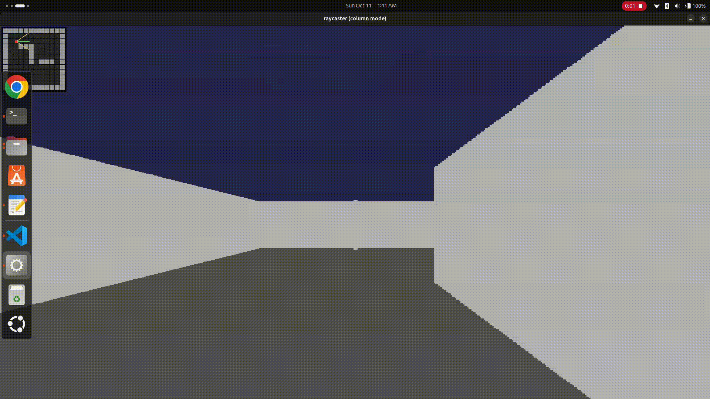

# raycasting in rtl

## overview

this project is an rtl implementation of a raycasting renderer, built to
explore how a graphics algorithm can be translated from software-style
calculations into hardware logic. the aim was not just to display a
raycasting result, but to work through the rendering pipeline in
systemverilog, connect the required modules, and get the design
producing pixel data that could be viewed in simulation.

getting the renderer to work involved breaking the algorithm into hardware-friendly stages, implementing map traversal and wall detection, calculating wall distance and boundaries, and generating pixel data with rgb values. the design was tested using verilator, with a c++/sdl program used to mimic a display screen and visualize the generated output. 

i've got the raycasting rtl working in verilator and have also generated the hdmi pixel output with rgb values. however, getting it to work on an actual hdmi or vga display would require some additional changes and testing. i initially expected to complete this within a week by spending around 2 hours daily after office, but it looks like it'll take a bit longer than planned. with other work to focus on, i'm winding up the project here for now. i'd like to revisit it in the future and try taking it to actual fpga hardware.

## how raycasting works

raycasting creates a 3d-like first-person view from a 2d grid map. each
cell in the map represents either empty space or a wall. for every
vertical column of the screen, a ray is generated from the player's
position, with its direction determined by the viewing direction and the
column's position on the screen. the ray travels through the grid until
it reaches a wall. the distance to that wall determines how tall the
wall appears, nearby walls occupy more vertical pixels, while distant
walls occupy fewer. repeating this process across the screen creates the
perspective effect without needing a full 3d scene representation.

the key challenge is finding the first wall a ray reaches efficiently.
this is where **dda (digital differential analysis)** comes in. rather
than moving along a ray in tiny increments. which can be inefficient
and may skip a wall. the algorithm compares the distance to the next
grid boundary in the x direction with the distance to the next boundary
in the y direction. it advances into the nearer cell and repeats until a
wall is detected. once the hit is found, the renderer calculates the
perpendicular distance to the wall and uses it to determine the wall's
top and bottom screen coordinates. using perpendicular distance helps
avoid the fisheye effect, where walls can appear curved as the viewing
angle changes.

## rendering pipeline

the overall process can be represented as:

``` text
          player position and view direction
                         |
                         v
                   ray generation
                         |
                         v
               dda map traversal
                         |
                         v
                   wall detection
                         |
                         v
             perpendicular distance
                         |
                         v
              wall height / boundaries
                         |
                         v
                pixel and rgb output
                         |
                         v
              display timing and output
                         |
                         v
                 verilator + sdl view
```

this flow is the conceptual path from the player's view to the rendered
screen. in the rtl, the work is split across modules so that ray
generation, map traversal, distance calculation, wall detection, memory
access, and display timing can be developed and debugged as separate
pieces.

## rtl structure

the following files are included in the verilator build.
```
  -----------------------------------------------------------------------
  file                                role
  ----------------------------------- -----------------------------------
  `rtl/starting_position.sv`          top-level module selected for the
                                      simulation build

  `rtl/top.sv`                        connects the main rendering
                                      components

  `rtl/dda_algo.sv`                   implements grid traversal to find
                                      the first wall cell reached by a
                                      ray

  `rtl/ray_generator.sv`              generates ray-related position and
                                      direction values

  `rtl/perpendicular_distance.sv`     calculates the perpendicular
                                      distance used for wall projection

  `rtl/sync_fifo.sv`                  synchronous fifo for buffering data
                                      between parts of the design

  `rtl/dual_port_ram.sv`              dual-port ram used by the design

  `rtl/timing_generation.sv`          generates display timing signals

  `rtl/wall_or_not.sv`                determines whether a queried map
                                      location is a wall

  `sim/sim_main.cpp`                  verilator simulation driver and sdl
                                      display code
  -----------------------------------------------------------------------
```
the table describes each module's intended role based on its name and
use in the build. for exact signal-level behaviour, refer to the
systemverilog source.

## simulation with verilator

the project was built and tested using verilator. the c++ simulation
driver uses sdl to display the output generated by the rtl, making it
possible to inspect the rendered result while developing the hardware
logic.

run the following command from the project root:

``` bash
verilator --cc --exe --build -j 4 \
  --top-module starting_position \
  -Wno-fatal -Wno-lint -Wno-style \
  rtl/starting_position.sv \
  rtl/top.sv \
  rtl/dda_algo.sv \
  rtl/ray_generator.sv \
  rtl/perpendicular_distance.sv \
  rtl/sync_fifo.sv \
  rtl/dual_port_ram.sv \
  rtl/timing_generation.sv \
  rtl/wall_or_not.sv \
  "$PWD/sim/sim_main.cpp" \
  -CFLAGS "$(sdl2-config --cflags)" \
  -LDFLAGS "$(sdl2-config --libs)"
```

the top module for this build is **`starting_position`**, defined in
`rtl/starting_position.sv`. `rtl/top.sv` is also included as a source
file, but it is not selected as the verilator top module.

after the build completes, run:

``` bash
./obj_dir/Vstarting_position
```

### tools required

-   verilator
-   a c++ compiler and `make`
-   sdl2 development libraries
-   `sdl2-config` available in the shell

## result

the raycasting renderer is working in verilator simulation, generating pixel data with rgb values to produce a 3d-like view from a 2d map. the gif below shows the rendered output in action.

<p align="center">
  
</p>

## project status

- tested the raycasting rtl using verilator with an sdl-based c++ display.
- generated hdmi pixel output with rgb values.
- actual hdmi/vga display and fpga implementation pending.

## reference and learning material

i referred to an online tutorial while learning the geometry and flow
behind raycasting. its explanations and diagrams helped me understand
dda traversal, ray direction, wall projection, and why perpendicular
wall distance is used.

-   **reference:** [lode's computer graphics tutorial](https://lodev.org/cgtutor/raycasting.html#Introduction)

## closing note

this project took time to understand, implement, connect, and
debug not just to get an image on the screen, but to make the
rendering logic work as rtl. i'm leaving it here as a completed learning
milestone for now while i move on to other work. i may come back to it
later and take it through an fpga implementation.
